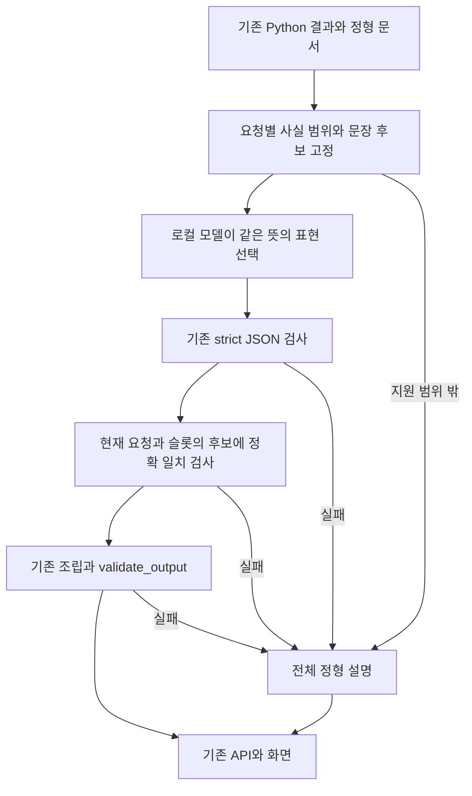

# M3.8C — 의미 오류 방지 설명 계약 보완 설계

작성일: **2026-10-26 KST**. 범위: **설계·문서 기록만**.

설계 판단: **M3_SEMANTIC_EXPLANATION_CONTRACT_DESIGN_READY**. 아래 계약은 구현 제안이다. 제품 코드·기존 Prompt·검증기·설정·모델은 변경하지 않는다. 실행 기능의 판단은 M3.8B의 **M3_LIGHTWEIGHT_LOCAL_LLM_INTEGRATED_QUALITY_REVISION_REQUIRED**를 유지한다.

**권장안은 서버가 현재 결과에 맞는 문장 후보를 만들고, 모델은 같은 뜻의 후보 중 표현만 선택하는 방식이다.** 모델의 자유로운 요약·인과 설명 권한을 줄이고, 응답의 모든 문장이 현재 요청의 허용 후보와 정확히 일치해야 채택한다. 원본 Python 값·정책 상태·UNKNOWN·근거·확인 행동은 계속 서버에서 제공한다.

## 1. 근거와 이번 작업의 경계

근거는 [M3.8B 실행 보고](M3_8B_LOCAL_NARRATIVE_INTEGRATION.md)와 [실제 합성 응답·검토 기록](../evidence/m3_8b_actual_evaluation.json)이다. 실제 고정30은 원문30개/검사 통과25개/전체 정형 대체5개였지만 채택 문장에도 의미 모순이 있었다. Python 원본 불변30/30과 문장 의미의 정확성은 각각 검증해야 한다.

이번에는 기존 코드·응답·기획 원칙을 읽고, 계약과 문서 예시를 정리한다. 새로운 후보 생성기·선택 검사기·Provider·테스트·API/UI를 구현하지 않는다. 실제 모델 요청·네트워크 호출·설치·재평가를 하지 않는다. 문서 예시의 기존 검사기 호환성 검사는 미래 계약의 구현 시험과 구분한다.

## 2. 오류별 원인과 설계 대응

| 실제 사례 | 발견된 설명 | 원인 | 보완 계약 |
|---|---|---|---|
| EX02/03 | 취업 입력이 바뀌었는데 p01은 취업상태가 변하지 않았다고 설명 | 이 정책의 비사용 조건과 전체 사용자 입력의 불변을 혼동 | 정책 문장은 해당 정책의 **조건 판정**만 서술. 전체 입력 불변 문장 금지 |
| EX06 | 미입력→미취업을 취업상태 유지로 요약 | UNKNOWN 해소와 동일 입력을 혼동 | 입력 변화와 조건 판정을 별도 자료로 관리. 미확인 해소는 전후 미확인 자료에서만 선택 |
| EX07 | 생활비 소득 증가로 정책 통과 | 생활비 계산값을 정책 소득 조건에 연결 | 예산 문장에 정책 통과 인과를 넣지 않음. 정책 후보는 금액 자료를 사용하지 않음 |
| EX09/10 | 지출이 변하지 않았다고 하거나 월세 감소를 수입 증가로 설명 | 다른 지표를 같은 경제 효과로 바꾸어 해석 | 지표명을 고정하고 해당 지표의 기존 delta만 사용. 월세·소득·여유자금의 이름과 부호를 서로 바꾸지 않음 |
| EX04/08/12 | 취업상태·소득·지출 유지의 근거 없는 인과 | 함께 관찰된 변화에 원인 관계 부여 | “줄었고/늘었으며” 같은 병렬 사실만 허용. 자유로운 원인·결과 문장 생성 금지 |
| EX01/20~30 | 일부만 UNKNOWN인데 모든 정책이 불명인 듯한 요약 | 정책별 불확실성을 전역 상태로 요약 | 요약은 예산·입력 비교 범위. 미확인은 정책 슬롯별 필수 문장과 기존 UNKNOWN 목록으로 표시 |
| EX11/13/15/16/17 | 승인·확정·충족·숫자 등의 금지 표현 | 생성 후 표현 검사에 의존 | 후보 자체를 기존 검증기로 검사하고 현재 후보 밖의 어떤 표현도 채택하지 않음 |

추가 금지어만으로 모든 의미 변형을 찾아내기는 어렵다. 모델을 다시 호출해 채점하게 하는 방식도 이번의 결정적 판단 경계와 시간 예산에 맞지 않는다. 따라서 **자유 서술을 유지한 채 의미 이해를 완벽하게 자동 검사한다는 약속은 하지 않는다.**

## 3. 비교한 대안과 권장 범위

| 방안 | 효과와 한계 | 판단 |
|---|---|---|
| Prompt에 주의문 추가 | 출력 경향을 바꿀 수 있으나 잘못된 동의어·인과를 구조적으로 차단하지 못함 | 보조 지시로만 사용 |
| 문장 의미를 별도 LLM으로 심사 | 두 번째 모델의 오류·추가 지연·평가 기준 문제가 생김 | 이번 범위 제외 |
| 모델이 문장을 만들고 근거 ID 첨부 | 올바른 근거 ID 옆에 틀린 문장을 붙일 수 있음 | 충분한 방어가 아님 |
| 서버가 같은 뜻의 문장 후보를 만들고 모델이 완성 문장을 선택 | 현재 요청의 후보 집합과 정확 비교 가능. 후보 작성·조건 매핑의 정확성은 별도 검증 필요 | **권장** |
| 기존 정형 설명만 제공 | 이미 동작하며 모델 지연·의미 변형 없음 | 현재 기본값 및 품질/효용 비교 기준 |

**Assumption / 설계 제안:** 첫 버전은 필드마다 의미가 같은 문장 후보 최대2개로 제한한다. 후보가1개여도 허용한다. 문장 수·선택 우선순위·표현은 이번의 권장안이며 사용자 평가를 거쳐 확정할 구현 상수다. 모델이 사실·강조 항목·누락 여부를 고르는 방식은 허용하지 않는다.

AI의 역할은 **자유 설명 생성에서 제한된 한국어 표현 선택으로 축소**된다. 이를 새로운 추론 능력·개인화·금융 조언으로 홍보하지 않는다. 자세한 “왜”는 기존 Python의 금액 행·조건 변화·근거·UNKNOWN·next_actions가 담당한다. 의미가 같은 표현 선택의 효용이 정형 설명보다 나은지는 미검증이며, 차이가 없다면 정형 기본값을 유지하는 것이 타당하다.

## 4. 보존 계약

| 대상 | 결정 |
|---|---|
| Policy / Cashflow / What-if / 금융 계산 | 기존 값·상태·알고리즘 그대로 사용 |
| ExplanationFacts / canonical 정형 문서 / render_document | 변경하지 않음 |
| M3.8A `prepare_narrative`, `parse_narrative`, `assemble_narrative` | 그대로 재사용하는 설계. 기존 함수 수정 없이 별도 경계에서 후보 검사 |
| 기존 `validate_output` | 규칙·금지어·오류 의미를 그대로 유지. 최종 조립 후 반드시 실행 |
| API / React DTO / 상태표시 / 입력 변경 무효화 | 기존 계약 유지 |
| 모델이 바꿀 수 있는 결과 필드 | summary와 각 정책 text의 한국어 문장만 |
| 전송 / 서비스 / UI 제한 | **6초 / 8초 / 12초** 유지 |
| 입력·출력 상한 | context4KiB, 전체 요청8KiB, 외부응답32KiB, 문장JSON4KiB, 요약60자/정책40자, 최대256토큰 유지 |
| 실행 방식 | 기존 로컬 모델·고정 loopback `/api/chat`, 생성1회, 자동 재시도·repair0 |
| 기존 데이터·회귀 | golden/GV01~GV15/BV01~BV16/Coverage freeze/실제 release6개 보존 |

실제 정책은 DRAFT / CONDITION_SLICE, ResidenceHistory는 OFFICIAL_INQUIRY_REQUIRED, M2.77은 SYNTHETIC_ONLY다. 검증되지 않은 실제 지원금0원·실제 상품 만기 계산0개·IBK 공식 회신 대기를 유지한다. 이번 설계는 합성 정책0~3개 범위이며 전국 실데이터 연결을 승인하지 않는다.

## 5. 제안 처리 흐름



후보 결정은 **표시 문장에 대한 선택**이다. 정책 PASS/FAIL/UNKNOWN을 규칙에서 다시 계산하거나 Cashflow 차액을 새로 산출하지 않는다. 기존 값과 상태에서 어떤 문장 묶음을 사용할지만 고정한다.

## 6. 서버 전용 의미 자료

아래는 미래 구현을 위한 개념 계약이며 현재 Python 모델/필드 추가가 아니다.

| 개념 | 원본 및 규칙 | 금지 사항 |
|---|---|---|
| `budget_directions` | `MoneyFact.field`와 이미 산출된 delta의 부호를 그대로 연결 | 월세 감소를 monthly_income 증가로 치환 금지. delta=None을0으로 취급 금지 |
| `global_input_changes` | 기존 facts.changed_input_fields. 정해진 한국어 필드명만 표시 | 특정 정책에 해당 규칙이 없다는 이유로 전체 입력 불변 추론 금지 |
| `policy_status_pair` | 해당 PolicyFact의 전후 최종 상태 그대로 | 규칙들을 새로 집계해 정책 상태 재판정 금지 |
| `evaluated_rule_changes` | 해당 정책의 RuleFact.input_changed와 전후 상태. 상세 표시/테스트 근거 | 비사용 입력은 단지 이 규칙 목록에 없다는 뜻. “전체 입력이 그대로”라는 문장으로 확장 금지 |
| `pending_before/after` | 해당 정책의 UNKNOWN 최종/조건 상태 또는 기존 missing 목록이 있는지를 표시. 어느 하나라도 있으면 pending | 최종 FAIL이라는 이유로 미확인 조건 제거 금지 |
| `missing_before/after` | 해당 policy의 기존 UnknownFact/RuleFact missing 목록. 현재 슬롯에만 귀속 | 개인 월소득으로 정책 가구소득을 보충하거나 다른 정책의 미확인 목록을 합쳐 넣지 않음 |

`pending`은 다음을 **각 시점별로** 관찰한 표시 플래그다: policy.status=UNKNOWN, 해당 rules 중 UNKNOWN, UnknownFact의 missing_fields, RuleFact의 missing 중 하나라도 있음. 전후 pending을 분리한다. 이는 새 자격 상태나 추가 지원금 상태가 아니다. 전체 FAIL에도 pending=true일 수 있다.

기존 M3.8A의 문서/Facts 일치·slot/ID/누락자료 정합성 검사를 먼저 통과해야 한다. 기존 정책/규칙 ID·순서·필드명·미확인 자료가 모순되면 후보를 추정하지 않는다. unknown 자료가 없거나 잘못 연결된 경우 기존 계약 오류로 처리한다. 지원하지 않는 새 필드/정책 수/상태는 전체 정형 경로로 보낸다. 손상된 canonical 문서 자체는 정상 모델 품질 실패로 숨기지 않는다.

## 7. 문장 후보 결정 규칙

### 7.1 요약: 사실 범위를 서버가 먼저 고정

요약은 예산 또는 입력 변화만 설명한다. 정책별 상태를 전체 정책의 단일 상태처럼 요약하지 않는다. 후보2개는 같은 사실과 같은 범위를 말해야 한다.

| 우선순위 | 이미 확인된 조건 | 허용 요약 묶음 |
|---|---|---|
| S1 | 사용자 저축 상한 입력이 변경됨 | 상한 설정 변경만 서술. 미입력↔영을 증가/감소로 쓰지 않음 |
| S2 | 월소득/월세/고정지출/기타지출 중 정확히1개 delta가0이 아님 | 그 지표와 월 여유자금의 **각각의** 기존 방향을 병렬로 서술 |
| S3 | 위 지출·소득 항목 여러 개가 변경됨 | “월 예산의 여러 항목이 달라진 비교예요.” 등 범위가 명확한 안내. 한 원인을 모델이 고르지 않음 |
| S4 | 예산 주요 항목은 같고 age/region/student_status/employment_status 등 지원 입력이 변경됨 | 서버 고정 순서의 첫 변경 입력 이름과 입력 변경만 서술. 나머지는 기존 상세 화면에 유지 |
| S5 | 입력 변경 없음, 금액 전후값 동일, 정책·조건 상태와 누락자료도 동일 | “바뀐 입력이 없어 비교 결과도 같아요.” |
| S6 | 지원되는 사실이지만 위 요약의 의미가 성립하지 않음 | “월 예산과 정책별 비교 결과를 함께 살펴보세요.” |

S6는 손상/알 수 없는 자료를 감추는 수단으로 쓰지 않는다. 그런 자료는 호출 전 계약 오류다. 여러 항목을 한 요약에서 생략해도 기존 changed_facts/조건 근거/UNKNOWN/next_actions는 빠짐없이 유지한다. S4의 표시 우선순위 제안은 age→region→student_status→employment_status다. 기존 목록에 없는 미래 사용자 필드를 임의 문자열로 넣지 않는다.

S2의 표기 예: monthly_rent.delta<0, disposable_after_policy.delta>0이면 다음 둘 중 하나만 허용한다.

- “월세는 줄었고, 월 여유자금은 늘었어요.”
- “월세는 줄었으며, 월 여유자금은 늘었어요.”

주어는 서버 필드명 표에서 선택하고, 각 지표의 동사는 그 지표 delta에서만 선택한다. 결과를 빼거나 더하지 않는다. “월세가 줄어서 소득이 늘었다”는 문장은 후보에 들어가지 않는다. delta=0이면 “같아요”, None이면 그 숫자 비교 문장을 만들지 않는다.

S1 예: “저축 상한 설정이 달라진 비교예요.” / “사용자 저축 상한의 설정 변화를 비교했어요.”. None과0의 구체적 차이는 기존 서버 숫자 행·가정에서 설명한다. 숫자 대신 한글 수량을 모델에 쓰게 하지 않는다.

### 7.2 정책: 판정 변화와 미확인 자료를 분리

후보는 **정책별로** 선택한다. 최종 상태의 같음/다름과 pending 전후로 아래 묶음을 하나 정한다. 최종 PASS라는 이유로 전체 행정 자격을 확정하는 표현을 만들지 않는다.

| 묶음 | 조건 | 동일 의미 후보A / 후보B |
|---|---|---|
| P1 | 최종 상태 같음, 전후 pending=false | 이 정책의 종합 판정은 같아요. / 이 정책의 종합 판정은 그대로예요. |
| P2 | 최종 상태 다름, 전후 pending=false | 이 정책의 종합 판정이 달라졌어요. / 이 정책의 종합 판정이 바뀌었어요. |
| P3 | 최종 상태 같음, after pending=true | 종합 판정은 같아요. 더 확인할 조건이 남아 있어요. / 종합 판정은 그대로이며, 추가로 확인할 조건이 있어요. |
| P4 | 최종 상태 다름, after pending=true | 종합 판정이 바뀌었어요. 더 확인할 조건이 남아 있어요. / 종합 판정이 달라졌고, 추가로 확인할 조건이 있어요. |
| P5 | 최종 상태 같음, before pending=true/after=false | 종합 판정은 같고, 비교한 조건의 미확인 표시가 해소됐어요. / 종합 판정은 같아요. 이전의 미확인 표시가 해소됐어요. |
| P6 | 최종 상태 다름, before pending=true/after=false | 종합 판정이 바뀌고, 비교한 조건의 미확인 표시가 해소됐어요. / 종합 판정이 바뀌었어요. 이전의 미확인 표시가 해소됐어요. |

**종합 판정은 해당 PolicyFact의 before_status/after_status(정책 종합 상태)만 가리킨다.** 최종 FAIL이 같아도 개별 규칙은 달라질 수 있으므로 “모든 조건 판정이 그대로”라는 문장은 쓰지 않는다. 정책별 최종 상태와 개별 조건 변화는 기존 화면이 각각 표시한다. “평가한/비교한 조건”은 현재 합성 엔진에 들어 있는 조건 범위다. 정책 전체 완결성·행정 확인·공식 증빙 심사를 뜻하지 않는다.

P3/P4는 **모든 후보에 미확인 문장을 포함**한다. 모델이 확인 문장을 빼거나 어투를 바꿔 부정할 수 없다. FAIL+missing도 P3/P4다. pending이 일부라도 남으면 P5/P6로 가지 않는다. P5/P6의 해소는 현재 비교 자료에서 미확인 표시가 없어졌다는 뜻이며 소득 증빙 검증·정책 이용 확정으로 확대하지 않는다. 이 표현의 이해도는 후속 사람 검토 대상이다.

규칙에 취업상태가 없는 p01에서도 취업 입력이 바뀔 수 있다. P1은 **종합 판정이 같다**고만 말하므로 EX02/03/19의 잘못된 “취업/지역 입력 불변”을 만들지 않는다. 어떤 규칙이 바뀌었는지는 기존 rules/source 표시를 사용한다. 전체 정책 자격·법적 권리 문장은 후보에서 배제한다.

### 7.3 후보 작성·선택의 불변조건

1. 필드마다1~2개의 **완성 문장**을 정한다. 후보를 조각으로 나눠 모델이 임의로 이어 붙이지 않는다.
2. 후보는 같은 사실과 동일한 불확실성 범위를 표현해야 한다. “예산 설명/정책 설명”처럼 다른 내용을 모델이 선택하게 하지 않는다.
3. 후보의 길이·금지 표현·Unicode·기존 검증기 호환성을 게시 전에 검사한다. 요청 시에도 지원 범위·크기를 확인한다.
4. 후보를 만들 때 사용자 원문·정책 원문·reason 문자열·source URL/경로를 문장에 삽입하지 않는다. label과 문구는 서버 상수다.
5. before/after/delta의 숫자는 모델 문장에 넣지 않는다. 기존 UI 값·UNKNOWN·actions는 생략하거나 대체하지 않는다.
6. 첫 단계의 어휘 집합은 **합성 사례용 검토 예정 문구**다. 기존 검사기 통과는 사람의 의미 검토 승인을 뜻하지 않는다.

## 8. 요청 전용 자료와 모듈 경계

| 미래 구성 요소 | 입력 → 출력 | 책임 |
|---|---|---|
| 의미 범위 선택 | 기존 Facts와 PreparedNarrative → 범위/조건 표시 자료 | 값·정책 재계산 없이 기존 항목을 연결 |
| 후보 준비 | 위 자료와 고정 catalog → `CatalogPrepared` | 요청별 불변 후보 tuple, 버전, 원본 V1 prepared, slot 매핑을 보관 |
| V2 Provider | 기존 generate payload → 완성된 기존 문서 JSON | 작은 후보 요청/응답, envelope, 기존 시간 제한 유지 |
| 후보 일치 검사 | 원시 응답과 동일 요청 CatalogPrepared → 기존 CheckedNarrative | 기존 parse 후 모든 문장의 현재 슬롯 exact membership 검사 |
| 기존 조립/검증 | V1 prepared와 검사 완료 텍스트 → ExplanationDocument | summary/text만 교체하고 기존 validate_output 실행 |

상기 명칭은 설계용이다. 새 dataclass·함수·모듈은 아직 없다. 현재 immutable V1 prepared를 감싸는 별도 wrapper를 권장하며 기존 private field나 validator를 직접 수정/우회하지 않는다. 필요 모듈은 후보 준비와 일치 검사 정도로 작게 시작하고 범용 규칙 플랫폼을 새로 만들지 않는다.

전역 mutable 후보 저장소·마지막 요청 캐시를 사용하지 않는다. 요청A의 응답을 요청B의 candidate set에 대조하지 않는다. 같은 문장이 두 요청 모두에서 참일 수 있으므로 문자열만으로 응답의 출처를 증명한다고 주장하지 않는다. 실제 전송은 기존처럼 각 요청의 prepared 객체와 묶고, 조립은 기존 request binding을 유지한다. 교차 요청 테스트를 별도로 둔다.

## 9. 경량 wire 계약

제안 wire 버전은 `narrative-catalog-v2`다. 모델에는 사실 원문을 다시 주지 않고 **이미 현재 결과에 맞게 정한 문장 후보와 slot**만 준다. 정확한 금액·정책/규칙 ID·조건 원문·reason/source·UNKNOWN 원본 배열·전체 정형 문서·실제 사용자 입력은 서버에 둔다.

아래는 **EX10에 맞춘 문서 예시**이며 실제 V2 모델 응답이 아니다.

```json
{
  "contract": "narrative-catalog-v2",
  "summary_options": [
    "월세는 줄었고, 월 여유자금은 늘었어요.",
    "월세는 줄었으며, 월 여유자금은 늘었어요."
  ],
  "policy_options": {
    "p01": [
      "이 정책의 종합 판정은 같아요.",
      "이 정책의 종합 판정은 그대로예요."
    ],
    "p02": [
      "이 정책의 종합 판정은 같아요.",
      "이 정책의 종합 판정은 그대로예요."
    ],
    "p03": [
      "종합 판정은 같아요. 더 확인할 조건이 남아 있어요.",
      "종합 판정은 그대로이며, 추가로 확인할 조건이 있어요."
    ]
  }
}
```

아래 한국어 system 지시 초안은 향후 구현용이며 기존 Prompt를 지금 바꾸지 않는다.

> 서버가 제공한 각 항목의 후보 중 하나를 그대로 선택하세요. 후보는 같은 사실을 다른 표현으로 말합니다. 문장을 수정하거나 합치거나 이유를 추가하지 마세요. summary와 모든 policy_texts 슬롯을 가진 JSON 하나만 반환하세요. 후보 밖의 문장이나 다른 키를 반환하지 마세요.

모델 응답의 외형은 V1과 같은 문장 JSON이다. **candidate ID·숫자·새 상태·선택 이유를 반환하지 않는다.**

```json
{
  "summary": "월세는 줄었으며, 월 여유자금은 늘었어요.",
  "policy_texts": {
    "p01": "이 정책의 종합 판정은 같아요.",
    "p02": "이 정책의 종합 판정은 그대로예요.",
    "p03": "종합 판정은 같아요. 더 확인할 조건이 남아 있어요."
  }
}
```

출력 schema의 각 string에는 해당 필드/슬롯 후보를 `enum`으로 넣는다. required/추가 필드 금지/0~3개 slot/60·40자 제한은 유지한다. schema 제약만 신뢰하지 않고 서버에서도 membership을 재검사한다. 후보1개면 enum1개, 정책0개면 policy_texts는 빈 객체다. 요청·context·전체 envelope가 각각 기존 상한을 넘으면 줄여 맞추거나 slot을 빼지 않고 호출 전 정형 경로로 보낸다. schema도 합산한 전체 요청8KiB를 측정해야 한다.

## 10. 응답 검사와 실패 계약

순서 제안:

1. 기존 로컬 전송과 envelope/완료 이유·모델 일치 검사를 유지한다. 최대1회 요청이다.
2. `parse_narrative(raw, v1_prepared)`를 그대로 실행해 strict JSON·중복 key·type·slot·길이·Unicode·금지 표현·기존 UNKNOWN 부정 검사를 적용한다.
3. summary는 **이 요청의 summary 후보**, policy_text는 **이 요청의 같은 slot 후보**와 정확한 문자열 동등성으로 비교한다. 모든 항목을 검사한다.
4. 검사한 동일 객체/텍스트만 기존 `assemble_narrative`에 전달하고 기존 request binding 및 `validate_output`을 그대로 사용한다.
5. 서비스에서도 기존 validator를 거친다. 어느 항목 하나라도 실패하면 기존 canonical 문서 전체로 대체한다.

공백 trim·NFKC/NFD 변환·오타 교정·부분 일치·유사도·candidate ID 치환으로 후보에 맞추지 않는다. JSON 공백·key 순서·표준 escape 표기는 기존 parse가 해석한 문자열 값으로 비교한다. 문장 값에 문구를 추가/삭제/다른 표현으로 치환하면 거부한다. 후보에 없는 문장을 서버 문장으로 몰래 바꾼 뒤 llm 성공으로 표시하지 않는다.

후보 밖의 정상 JSON은 기존 공개 오류 `UNSUPPORTED_NARRATIVE`로 전체 대체하는 방안을 권장한다. 서버 전용 진단명 제안은 `TEXT_NOT_IN_REQUEST_CATALOG`다. 새 공개 DTO/상태 enum을 만들지 않는다. 잘못된 JSON/응답 크기/timeout/offline의 기존 오류 의미는 유지한다. malformed raw나 손상 canonical에 대한 기존 오류와 후보 생성의 내부 결함을 혼동하지 않는다. 고장난 canonical을 성공 fallback으로 포장하지 않는다.

해당 후보가 before/after 의미와 맞는지는 모델 응답 수신 후 임의 추론하지 않는다. 서버의 후보 작성 규칙과 의미별 회귀·사람 검토가 책임진다. closed-set 일치가 보장하는 것은 **허용 문장 밖으로 나가지 않았음**이며, 잘못 만든 catalog의 진실성을 자동 증명하는 것은 아니다.

## 11. 기존 기능과 연결하는 방식

별도 opt-in 이름 제안은 `AIX_EXPLANATION_CONTRACT=narrative_catalog_v2`다. 이 값은 **현재 지원되지 않는다**. 현재 factory는 알 수 없는 contract를 NoProvider로 처리하며 이번에 수정하지 않는다. V1 Prompt나 기존 `narrative_v1`을 같은 버전명 아래 조용히 바꾸지 않는다.

후속 구현 승인 시 새 준비/선택 검사와 제공자를 최소 범위로 연결하고, 기존 service/Facts/DTO/코어/검증기/API/React는 유지한다. legacy와 V1 회귀를 보존한다. 현재의 기본 NoProvider와 실험 경로 품질 보류도 그대로다. 모델은 기존 Ollama0.40.11/Qwen3 4B를 재사용하는 계획이며 새 설치·학습·API키는 요구하지 않는다.

메타데이터 한계도 남는다. 기존 service의 ai_executed는 Provider 정상 반환 뒤에만 true가 돼 실제 생성 후 거부도 false로 표시될 수 있다. 이 설계에서 수정하지 않는다. 향후 실제 검증도 전송 계수/완료 응답/채택/대체를 별도로 기록해야 한다. 문장 선택 통과를 모델 추론 정확도·사용자 이해도 향상으로 표시하지 않는다.

## 12. 요구되는 검증 계획 — 아직 미구현

| 검증 묶음 | 필수 사례 및 완료 기준 |
|---|---|
| 후보 의미 규칙 | S1~S6/P1~P6를 표 기반으로 검증. 후보마다 원본 의미 전제와 결과를 대조 |
| 정책 상태 | PASS/FAIL/UNKNOWN 전후9조합. 원래 status pair 불변 |
| 입력과 판정 분리 | 전체 취업/지역 입력은 변경됐지만 p01 규칙에는 없음, 개별 규칙이 바뀌어도 final FAIL 유지, 입력 변경이어도 final 유지, 같은 입력·상태 변화 자료의 정상/오류 범위 구분 |
| 미확인 | UNKNOWN 유지/생성/해소, 일부만 해소, 최종 FAIL+missing, 서로 다른 정책의 missing, UNKNOWN인데 자료 누락/불일치 |
| 금융 지표 | 월세만 감소, 소득만 증가, 지출 여러 개 변화, delta0, 적자·여유자금0, 저축 상한None↔0↔양수, 잘못된 지표명 바꿔치기 |
| 엄격한 선택 | 후보 그대로만 허용. slot 간 다른 후보/요약과 정책 문장 바꾸기/한 절 삭제/공백 추가/Unicode 변형/없는 문장/추가 설명/추가 key/중복 JSON key/빈 문장 거부 |
| 요청 격리 | A/B 후보 집합을 바꾸어 전달, 동일 형태 slot이지만 의미 다른 요청, 동시 요청, 허용 문장 자체가 겹치는 경우와 binding 검증 구분 |
| 크기·자원 | 0~3개 정책·후보1~2개, 요약60/정책40 code point 및 바로 초과, context4KiB/요청8KiB/응답32KiB/문장4KiB, 토큰256·완료이유·기존6/8/12초/대체 |
| 원본·기존 회귀 | 변경 가능한 두 텍스트 영역 외 deep equality. 기존M3.8A139/Provider68·UI/API·golden/GV/BV/freeze/release6 보존 |
| M3.8B 재현 | 실제 EX02/03/04/06/07/08/09/10/12/19 및 전역UNKNOWN 요약·금지표현 원문을 거부 회귀 자료로 사용. 후보 밖 문장의 실제 거부를 검증 |

순수 시험에서 정책 상태·돈을 모델 결과로 산출하지 않는다. 거부 회귀 자료에 대해 V1이 이미 거부했는지, 새 후보 경계가 추가로 거부했는지를 구분한다. 과거 JSON을 재사용한 시험은 새로운 실제 모델30 실행 실적으로 세지 않는다.

향후 실제 평가에서도 고정30 원본을 유지하고 fault label을 fake 오류 주입으로 바꾸지 않는다. 중복 입력/cache를 공개하고 별도 cold/HTTP/UI 요청도 센다. EX21~30만으로 서로 다른 새 의미 사례10개를 검증했다고 주장하지 않는다. 부족한 의미 경계 사례는 별도 합성 회귀 묶음으로 추가한다.

## 13. 완료 관문과 품질 판단

1. 현재 catalog에서 나온 모든 후보가 기존 parser/validator와 호환된다.
2. 원본 값·상태·UNKNOWN·근거·행동 불변, 현재 slot/request 밖 문장 채택0, 탐지한 실패는 전체 정형 대체다.
3. 표에 정의된 후보 의미 전제를 시험한다. M3.8B의 잘못된 인과·지표·입력 불변·전역 UNKNOWN 문장은 허용 집합에 없다.
4. 기존 회귀·시간 제한·실제 release/freeze가 유지된다.
5. 후속 실제 모델30개를 실행하고 cold/timeout/검사 거부/후보 선택 통과를 사실대로 기록한다. 예전25/30을 새 계약 실적으로 재사용하지 않는다.
6. 사람의 한국어 검토와 정형 설명 대비 효용 검토를 분리한다. 검토하지 않은 항목은 미실행이다. 후보 작성 자체가 사람에게 승인됐다는 전제도 두지 않는다.

M3.8B의 warm27/30은 초기 제안 목표였으며 새 계약의 성과로 자동 승계하지 않는다. 이번 설계도 높은 선택 성공률보다 **후보 밖 문장 채택0·원본 불변·의미별 증거**를 우선한다. 실제 수용률 목표와 효용 기준은 후속 실행 전 문서로 확정할 제안 사항이다. 후보2개의 어미만 달라져 효용이 없다면 모델 기본 활성화의 이유가 되지 않는다.

## 14. 작은 구현 순서 제안

**다음 최소 작업 하나: M3.8D — 요청별 문장 후보 준비·정확 일치 검사의 순수 구현 및 합성 검증.**

- 목적: 모델 없이 후보의 사실 범위·미확인 보존·현재 요청/slot 일치·기존 V1 조립 호환성을 검증한다.
- 범위: 고정 catalog와 후보 준비/선택 검사 경계, 표 기반 합성 시험, 문서·Obsidian 갱신만 제안한다.
- 선행조건: 사용자가 이 설계와 AI 역할 축소·문장 후보 범위를 검토한 뒤 구현을 승인한다.
- 완료조건: S/P 의미별 전제와 negative 사례 통과, 기존 validator·원본 불변, 변경 범위·동결 자료 감사, 미구현 Provider/API와 명확히 분리.
- 이번에 하지 않을 것: factory 등록·기존 Prompt 변경·실제 모델 실행·화면/API 변경·새 데이터/상품 계산 연결.

그 다음 실제 Provider/30개 평가는 M3.8D 결과에 따라 별도로 범위를 정한다. 이번 설계 완료를 후속 구현·실험·운영 활성화 승인으로 해석하지 않는다.

## 15. Assumptions와 남은 결정

| 항목 | 구분 |
|---|---|
| 모델 자유 문장 생성 대신 의미가 같은 후보 선택 | 이번 권장 설계. 제품의 AI 역할 축소를 명시하고 사용자 검토 필요 |
| 첫 구현 후보 최대2개·요약 우선순위·P1~P6 문구 | 제안. 사람의 어휘/가독성 검토·표 기반 시험을 거쳐 확정 |
| 기존 text JSON 외형/validator/6·8·12초 | 보존 요구사항. 변경 제안 없음 |
| candidate schema enum을 런타임이 잘 수행함 | 실제 V2 모델 실행 미검증. schema만으로 성공 보장하지 않음 |
| 후보 입력이 기존보다 작거나 빠름 | 문서 예시 바이트만 확인 가능. 실제 성능 보장 없음 |
| 의미 오류 완전 제거 | 보장하지 않음. 후보 작성/전제 선택/원본 자료/해석 오류는 별도 책임 |
| 같은 의미의 문장 선택이 더 유용함 | 미검증. 정형 기준과 사람 평가가 필요 |
| 운영·기본 모델 활성화 | 보류. 현재 NoProvider 정형 유지 |

## 16. 이번 설계의 검증·기록과 최종 판단

이번 산출물은 이 설계서와 **문서 예시 검사 기록**이다. JSON 예시 문법·길이·문서 링크·기존 parser/validator와의 문서 예시 호환성을 확인한다. 미래 후보 생성기/일치 검사 구현·새 제품 시험·실제 모델 실행 성과가 아니다.

제품 전체 회귀를 다시 실행하지 않는다. 직전 M3.8B의 Backend11940passed/1skipped/1warning, Frontend115passed/빌드 성공은 **이전 실측**으로 남긴다. 기존 모든 repository 파일 SHA256/크기/mtime와 release6을 전후 감사한다. M3.8B 응답/실패/회귀 원문을 수정하지 않는다.

Obsidian에는 같은11개 절의 새 M3.8C 설계 노트와 대시보드·현재 개발·할 일·계약·검증 기록을 연결한다. 설계 완료와 제품 품질 보류를 구분하고, Wikilink/제목/블록/source_paths/로컬 링크/Bookmarks/Base/Canvas/템플릿을 검사한다. 앱 설정·커뮤니티 플러그인·구버전 최신 완료 Bookmark M3.1은 그대로 두고 GUI 미확인을 유지한다.

**M3_SEMANTIC_EXPLANATION_CONTRACT_DESIGN_READY — 설계만 완료.** 기존 실행 기능은 품질 보류이며 실제 상품 계산0개·지원금0원·정책/거주기간/M2.77/IBK 회신 대기 상태는 변하지 않는다. 게시 후 문서·보존·Vault 검사 수치는 아래에 추가한다.

## 17. 문서 예시 검사 결과

[검사 기록](../evidence/m3_8c_design_example_checks.json)에 문법상 JSON 예시2개, 정책 후보12문구, 요약 예시11문구를 기록했다. 후보의 기존 텍스트 검사 호환성과 문서 예시의 슬롯을 확인했다. 정책 후보 최대34 code points, 요약 예시 최대26자로 기존40/60 이내다.

EX02/06/07/10/19의 **수작업 설계 예시5건**을 M3.8B에 저장된 Facts/canonical과 기존 V1 parser→조립→기존 validator에 넣어 호환성과 비텍스트 원본 불변을 확인했다. 실제 모델 응답이나 미래 V2 후보 선택 검사 실행이 아니다. 이 검사는 현재 V1이 문장 의미를 판별하지 못하는 한계를 없애지 않는다. P1~P6의 완전한 사실 매핑·동일 의미 보장은 후속 구현 시험/사람 검토가 남는다.

EX10 문서 예시의 compact UTF8 크기는 context552bytes/후보 enum과 system을 포함한 전체 요청2087bytes/문장 응답272bytes다. 모델에 보내지 않고 문서의 메모리 객체로 측정했다. 최대 경계값·실제 token/속도·모델 수용률을 측정한 것이 아니다.

설계 검토 중 **종합 상태 유지와 개별 규칙 상태 유지도 서로 다르다**는 점을 명시했다. 후보는 “종합 판정”이라고 쓰고, 규칙 변경 후에도 최종 FAIL이 유지되는 사례를 미래 검증 표에 넣었다. 이 구분 없이 “조건들이 그대로”라고 서술하는 방식은 채택하지 않았다.


## 18. 최종 보존·Obsidian 검사

기존 repository **315개 전부의 SHA256·크기·mtime 불변**을 확인했다. 추가 파일은 이 설계서와 문서 예시 검사 JSON2개뿐이다. M3.8B 원문/실행 기록, 기존 Python 값·정책 엔진·UNKNOWN·검증기·Prompt·시간 제한·테스트/golden·Coverage freeze·실제 release6개를 보존했다. 실제 release6 SHA256은 검사 JSON의 보존 감사에 포함했다.

Obsidian은 기존13노트 갱신/신규 설계노트1개다. 최종 Markdown72/Wikilink624(제목15·블록1)/source_paths356/로컬파일링크63, 깨진링크0이다. Bookmarks13·4그룹/Base1/Canvas1/템플릿5/기존 앱 설정을 보존했다. GUI 미확인과 구버전 최신 완료 Bookmark M3.1 상태는 그대로다. 설계 노트는 completed/design_only이고 제품 품질은 보류다.

문서 예시 검사에서 새 보고서의 자기 참조 JSON 링크를 게시 전 원본 경로에서만 검사하여1회 실패했다. staging에도 존재하는지 확인하도록 문서 검사 도구를 보완하고 재실행했다. 최종 원본 경로에서도 모든 상대 링크가 존재한다. 제품 구현·모델·pytest 변경/재실행은 없었다.

**최종: M3_SEMANTIC_EXPLANATION_CONTRACT_DESIGN_READY.** 다음 최소 제안은 M3.8D의 모델 없는 후보 준비·정확 일치 검사 구현/합성 검증이며 아직 승인·구현하지 않았다.
